<div align="center">

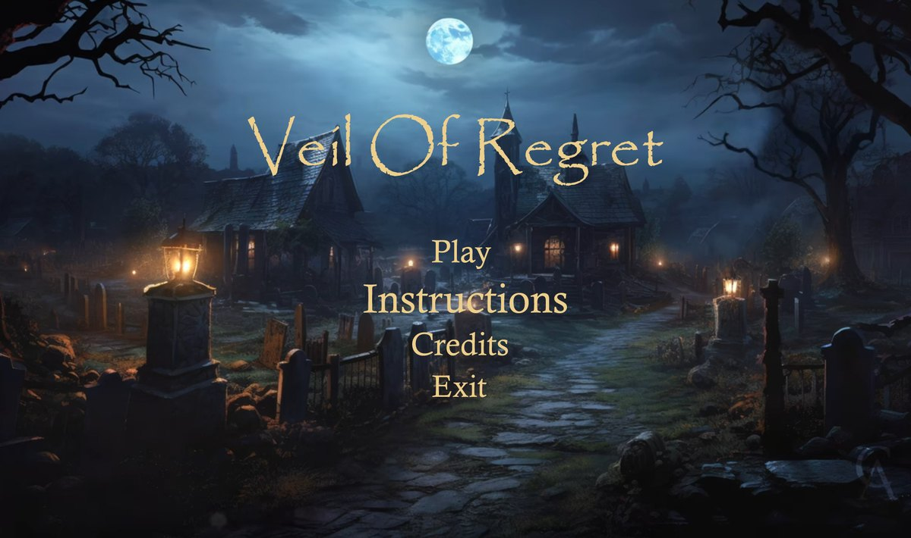

# 🕯️ Veil of Regret

### *Every monster is a memory. Every memory wants you dead.*

A hand-built **2D psychological horror** game in **C++ & OpenGL**. Fight your way through a haunted town
where every enemy is one of Aralyn's emotions: Fear, Guilt, Paranoia and, last of all, **Regret**.


[**▶ Watch the Gameplay Trailer**](https://www.youtube.com/watch?v=y2ESBHk0jxs) · [How to Play](#-how-to-play) · [Build & Run](#-build--run)

</div>

---

## 🎬 Trailer

<div align="center">
<a href="https://www.youtube.com/watch?v=y2ESBHk0jxs">
  
</a>
<br/><sub>Click to watch the full gameplay on YouTube</sub>
</div>

---

## ⚡ By the Numbers

<div align="center">

| 🎞️ **901** | 🎬 **484** | 👹 **16** | 🧩 **3** | ⚔️ **4** | 🧠 **~2,850** |
|:---:|:---:|:---:|:---:|:---:|:---:|
| hand-placed image frames | frames of animated cinematics | enemies across 6 creature types | unique puzzle mechanics | weapons that evolve with the story | lines of hand-written C++ |

</div>

No game engine, no Unity, no Unreal. Every animation, every collision check and every cutscene runs on raw C++
over OpenGL/GLUT, with a custom frame-animation system built from scratch.

---

## 📖 The Story

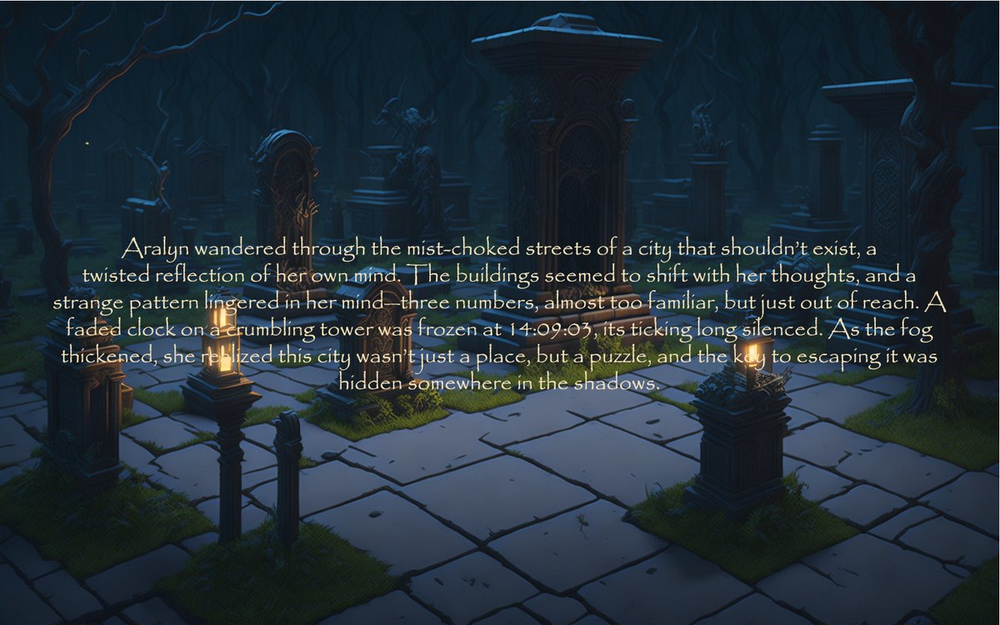

> *Aralyn wandered through the mist-choked streets of a city that shouldn't exist, a twisted reflection of her own mind.
> A faded clock on a crumbling tower was frozen at 14:09:03, its ticking long silenced…*

The town is called **Hollowcreek**. It has trapped Aralyn and fills itself with monsters made of her own guilt and fear.
To escape she has to fight them, solve the riddles her mind has left behind, and finally face what she did.
**And the ending isn't what you think.**

---

## 🎥 Fully Animated Cinematics

The story plays out through **484 frames** of frame-by-frame cutscenes, each one synced to its own soundtrack.

<div align="center">

| The Clock Stops | Waking in Hollowcreek | A Memory Resurfaces |
|:---:|:---:|:---:|
| 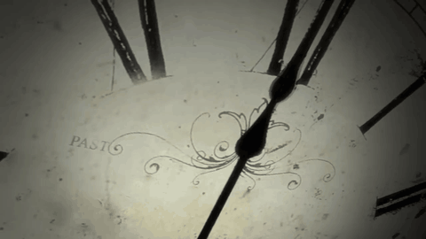 | 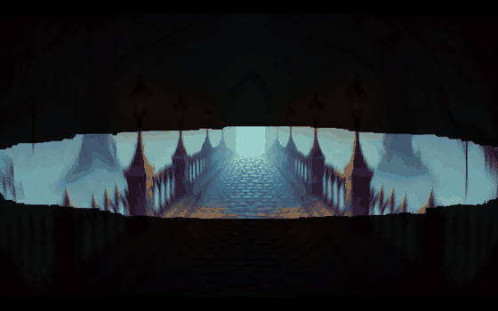 | 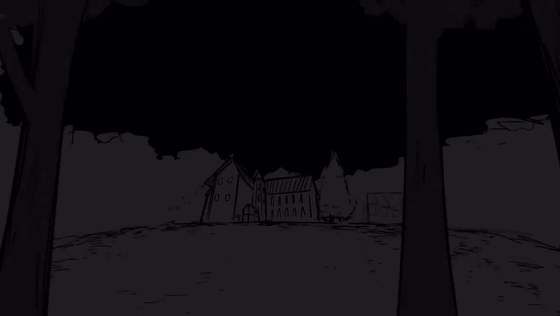 |
| *165-frame opening sequence* | *The eye opens* | *Hand-drawn memory flashback* |

</div>

---

## 👹 The Bestiary: Monsters Made of Emotion

Every enemy is a feeling Aralyn never dealt with, and each one has its own **walk, idle, attack and death animations**.

<div align="center">

| | Creature | Represents | Chapter | Count | Damage / hit |
|:---:|:---|:---|:---:|:---:|:---:|
| 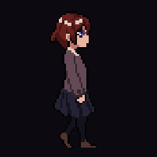 | **Aralyn** | *You* | All | 1 | 5 → 20 |
| 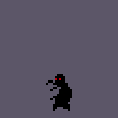 | **Fear** | The dread that follows you | I | 1 | 10 |
| 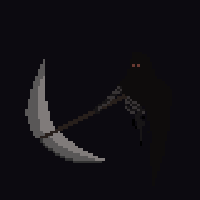 | **Reaper** | Fear of death | I | 2 | 10 |
| 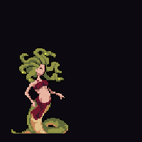 | **Guilt** | What you can't take back (3 variants) | II | 3 | 15 |
| 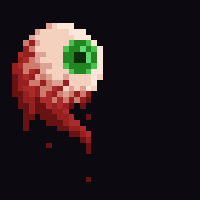 | **Paranoia** | The eyes that are always watching | III | 6 | 3 |
| 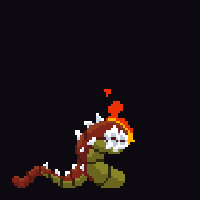 | **Fireworm** | Anxiety that burns from within | III | 3 | 7 |
| 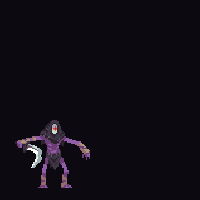 | **Regret** 💀 | **The final boss** | III | 1 | 15 |

</div>

### How hard each monster hits

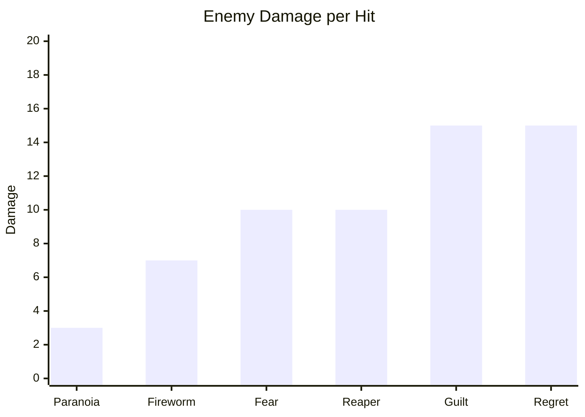

Paranoia hits the softest, but it comes in **swarms of six**. Chapter III throws 10 enemies at you at once before Regret arrives.

---

## 🗺️ Three Chapters into the Mind

<table>
<tr>
<td width="33%" align="center">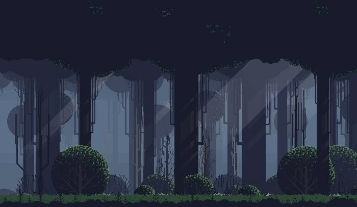<br/><b>Chapter I: The Forest of Fear</b><br/><sub>Crack the frozen clock's code, then survive Fear and two Reapers.</sub></td>
<td width="33%" align="center">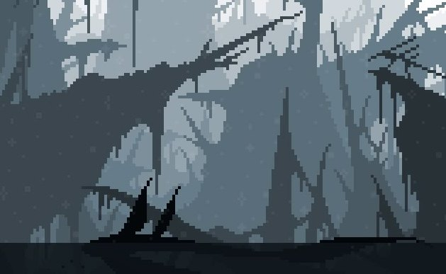<br/><b>Chapter II: The Swamp of Guilt</b><br/><sub>Pair the emotions that belong together, then face three Guilts at once.</sub></td>
<td width="33%" align="center">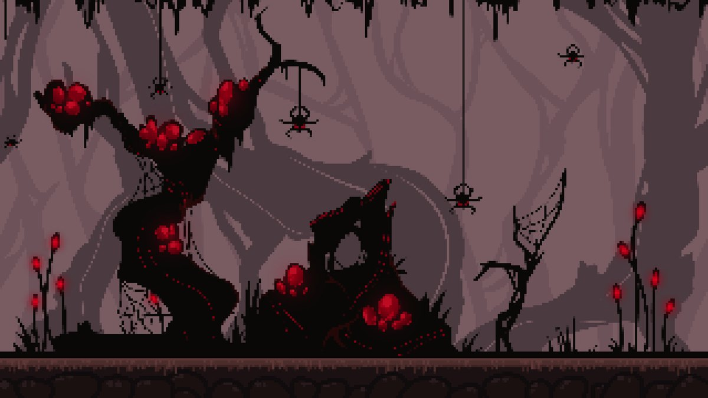<br/><b>Chapter III: The Crimson Hollow</b><br/><sub>Answer three riddles, survive the swarm, and confront Regret.</sub></td>
</tr>
</table>

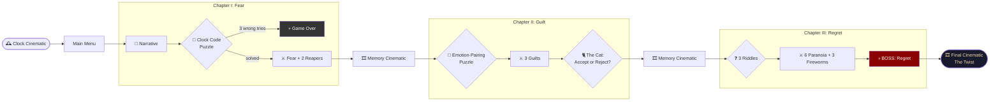

---

## 🧩 Puzzles That Tell the Story

Every puzzle is a clue to what happened to Aralyn, not a random gate.

<table>
<tr>
<td width="50%">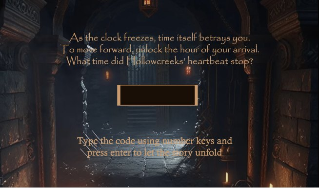<br/><b>The Frozen Clock</b>: <i>"What time did Hollowcreek's heartbeat stop?"</i> The answer is hidden in the story you just read.</td>
<td width="50%">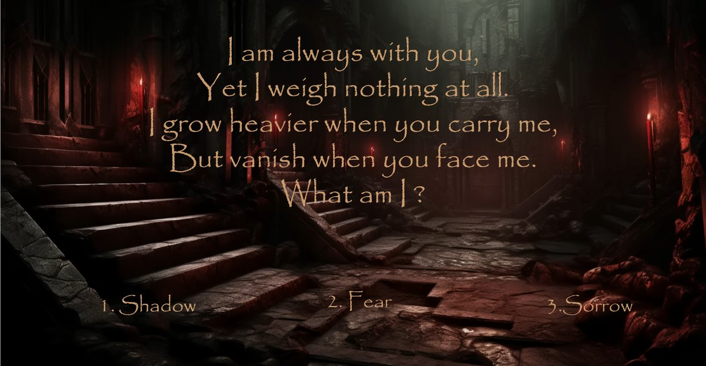<br/><b>The Riddles</b>: <i>"I am always with you, yet I weigh nothing at all…"</i> Three riddles stand between you and Regret.</td>
</tr>
</table>

### 🐈 A Choice That Matters

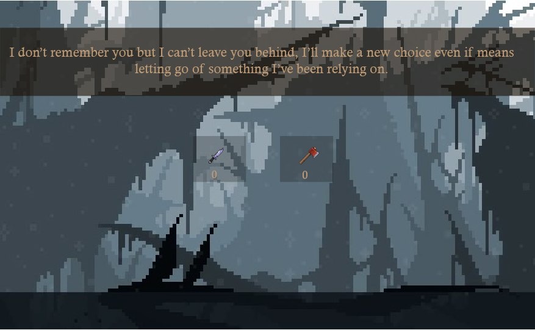

After Guilt falls, a stray cat finds Aralyn. **Take it in, or turn it away?** The choice is yours, and Aralyn has to let go of something either way.

---

## ⚔️ An Arsenal That Grows With You

Aralyn's weapon changes as the story goes on.

<div align="center">
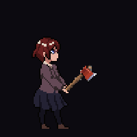
</div>

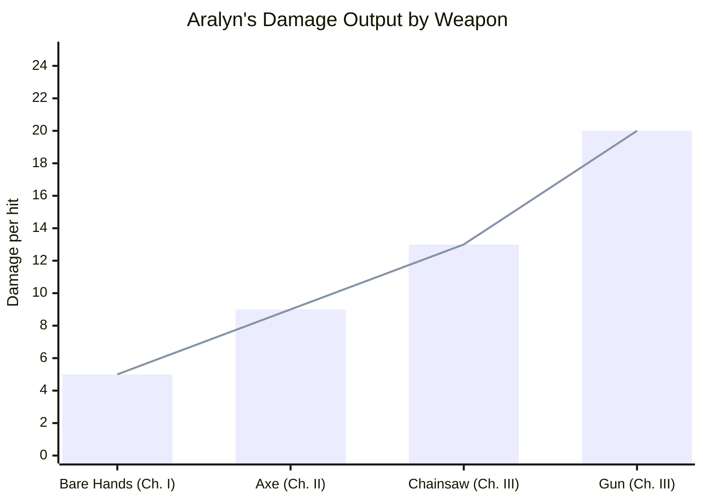

In Chapter III you can **swap weapons mid-fight**. Use the chainsaw `1` up close, or switch to the gun `2` and fire projectiles from range.

---

## 🛠️ Under the Hood

Built without an engine, on top of the **iGraphics** wrapper around OpenGL/GLUT:

- **Custom animation engine**: a reusable `Animation` class streams numbered frame sequences with per-clip timing, looping and audio sync. It drives all 484 cinematic frames.
- **Object-oriented combat**: `Enemy` inherits from `Player`, so every monster reuses the same movement, attack-cooldown and health-bar code, with chase-and-attack AI added on top.
- **AABB collision detection** for melee hits and a full **projectile system** for the gun.
- **Infinite scrolling backgrounds** that move with the player.
- **State-driven game flow** that ties menus, narrative screens, puzzles, fights and cutscenes together, with chapter select and restart at any point.
- **Image loading** through `stb_image` and **audio** through the Win32 `PlaySound` API, with 4 soundtracks for menu, intro, cinematics and game over.

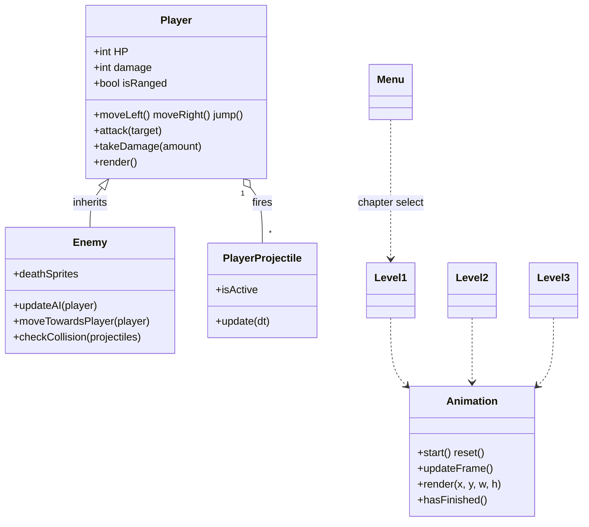

### What the 901 frames are made of

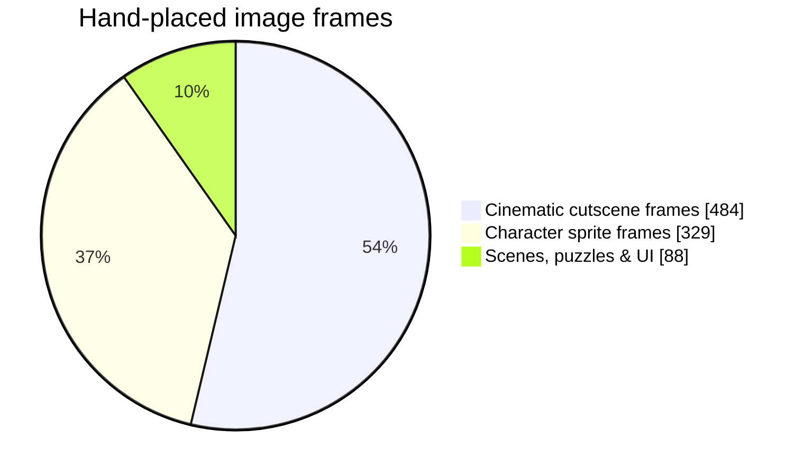

---

## 🎮 How to Play

| Action | Key |
|:---|:---:|
| Move left / right | `←` `→` |
| Jump | `↑` |
| Attack | `End` |
| Switch to chainsaw (Ch. III) | `1` |
| Switch to gun (Ch. III) | `2` |
| Continue story / confirm puzzle | `Enter` |
| Next narrative page | `Space` |
| Accept / reject the cat | `Page Down` / `Page Up` |
| Skip intro to menu | `Home` |
| Back to chapter select | `Esc` |

**Rules of survival**
- Aralyn starts each fight with **100 HP**.
- Clear all **three chapters** to escape Hollowcreek.
- **Jump** to dodge incoming attacks.
- **Pick enemies off one at a time.** Getting surrounded is how you die.
- A wrong answer to a puzzle can end your run.

---

## 🚀 Build & Run

**Requirements:** Windows · Visual Studio 2013 (or newer with the v120 toolset) · iGraphics/GLUT (included in this repo)

```bash
git clone https://github.com/isratarna/Veil-of-Regret.git
```

1. Open **`sample veil of regret.sln`** in Visual Studio.
2. **Build → Build Solution**.
3. **Debug → Start Without Debugging**.

> 💡 Run from the project folder so the game can find its `Images/` and `Audio/` directories.

---

<div align="center">

### *Can you face what you've been running from?*

[**▶ Watch the trailer**](https://www.youtube.com/watch?v=y2ESBHk0jxs)

</div>
